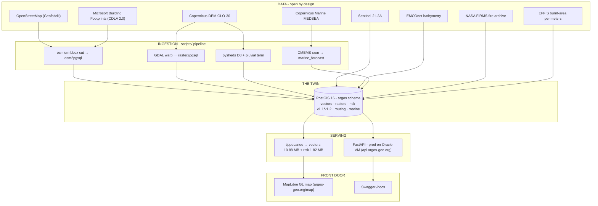

# ARGOS : : Kefalonia Digital Twin

**The map that argues back.**
*«Η Κεφαλονιά μέσα από τα δεδομένα της»*

ARGOS is an open-source digital twin of **Kefalonia, Greece** - one island, fully
mapped, queryable, and watchable. Built in public by one person, on open data and
free-tier infrastructure.

**[🗺️ Open the live map](https://argos-geo.org/map)** - roads, buildings, beaches,
wildfire risk, flash-flood risk, fire-response coverage, and modelled marine
exposure for 14 pilot beaches. Click anything; it answers.

---

## The 3-minute version

**What is it?** A PostgreSQL/PostGIS database that holds the whole island -
12,217 road segments (3,764 km), 46,934 buildings (OSM + Microsoft footprints,
conflated), 1,831 POIs, 197 beaches, 29 trails, terrain (Copernicus DEM 30 m),
vegetation (Sentinel-2), EMODnet bathymetry, and four screening layers with directional validation where independent evidence exists -
served through a FastAPI and a static vector-tile map.

## What already works (v0.2.0)

### Map (argos-geo.org/map)
- Base: 12,217 road segments (3,764 km), 46,934 buildings (OSM + Microsoft conflated), 1,831 POIs, 197 beaches, 29 trails, municipalities, terrain hillshade, EMODnet bathymetry contours, northern context coastline (incl. Corfu group)
- Risk layers: Wildfire Risk v1.2 (validated against 24 EFFIS perimeters, 21/24 above island mean, and 397 NASA FIRMS detections; directional validation, not proof), Flash-Flood Risk v1.1 (validated against the Feb 2025 storm and the ΓΓΠΠ Sep 2022 historical flood map; Katavothres karst blind spots documented), Fire-response coverage (pgRouting, 21,811 segments; 76.6% of buildings beyond the 15-minute envelope; median response OSM 43.4 min, Microsoft 33.3 min)
- Marine: 14-beach exposure layer with per-beach 48 h exposure sparkline in popups; animated current streaks; animated wave-height streaks; current-speed field; SST. Unvalidated (no independent buoy on Kefalonia); first in the validation queue.
- Live: weather now (13 points), FWI index, temperature field, EFFIS FWI grid, earthquake layer (EMSC, M≥2.5, Ionian box, 2 min refresh)
- ASK THE TWIN: precomputed answers to curated questions, computed from the live database at analysis time (4 demo questions)
- Bilingual EN/EL throughout; mobile-adapted

### API (api.argos-geo.org)
/layers, /buffer, /intersect, /aggregate, /marine/beaches, /marine/exposure, /weather/now, /fwi/latest and related live endpoints; demo queries < 500 ms

### Automation
- Daily Bluesky digest 07:05 EET with generated data card (wave, FWI, temperature, quakes)
- Earthquake poster (M≥3.0, 10 min check)
- Quake fetch every 2 min

### ARGOS analyses vs. integrated external products

**ARGOS analyses (our models, our validation):** Wildfire Risk v1.2 (CLC 2018 fuel, slope, aspect, roads, MODIS fire history); Flash-Flood Risk v1.1 (D8 fluvial + pluvial ponding on Copernicus DEM 30 m); Fire-response coverage (pgRouting, single station origin ΠΥ Αργοστολίου); Marine exposure score (0-100 index computed from CMEMS wave + current models).

**Integrated external products (displayed, not modelled by us):** EFFIS / Copernicus EMS FWI (daily rasters, reference context only); CMEMS Mediterranean wave model (MEDWAM, 4 km, hourly); CMEMS Mediterranean physics model (surface currents, SST, 4 km); Open-Meteo (weather now, 13 model points); EMSC-CSEM (earthquakes, M≥2.5, Ionian box); EMODnet (bathymetry contours, display only).

**What it costs to run:** €0/month, including always-on production (Oracle Always
Free ARM VM + Cloudflare Pages + GitHub Pages).

## Architecture

Run locally with `docker compose up -d` in a GitHub Codespace - see
[`DEV_SETUP.md`](DEV_SETUP.md). Every pipeline step is a numbered, committed
script in [`scripts/`](scripts/); every model has an open methodology document
([wildfire](METHODOLOGY_Wildfire_Risk.md) ·
[flash flood](METHODOLOGY_Flash_Flood.md) ·
[accessibility](METHODOLOGY_Accessibility.md)) with an honest limitations section.

## The three sub-brands

| Mark | What it is |
|---|---|
| **ARGOS GEO** | The twin itself - data, pipelines, API, map |
| **ARGOS WATCH** | The monitoring and validation program: hazard screening layers checked against real events, hit rates published, misses logged |
| **ARGOS COMMONS** | Citizen input and open data stewardship - the open horizon |

## Honest status

The risk layers are expert-weighted **screening baselines with directional
validation, never forecasts**. Real-time feeds and dynamic risk are v0.2.0
(roadmap in the issues). The marine layer is unvalidated (no independent buoy on
Kefalonia) and says so on the map. Ithaca buildings show honest no-data gray
until travel-times v1.1 (ferry legs) ships.

## Data & licenses

Code: **MIT**. Derived layers: **CC BY 4.0**. Sources: © OpenStreetMap contributors
(ODbL), Microsoft Building Footprints (CDLA Permissive 2.0), Copernicus DEM,
Sentinel-2 / ESA, NASA FIRMS, EFFIS / Copernicus EMS, EMODnet, Copernicus Marine.
Attribution is architecture, not decoration.

---

## Ελληνικά 🇬🇷

# ARGOS : : Ψηφιακός Δίδυμος Κεφαλονιάς

**Η Κεφαλονιά μέσα από τα δεδομένα της.**

Ο ARGOS είναι ένα ανοιχτού κώδικα ψηφιακό δίδυμο της **Κεφαλονιάς** - ολόκληρο το
νησί, χαρτογραφημένο, ερωτήσιμο και παρατηρήσιμο. Χτίζεται δημόσια από έναν
άνθρωπο, με ελεύθερα δεδομένα και δωρεάν υποδομή.

**[🗺️ LIVE map](https://argos-geo.org/map)** - δρόμοι, κτίρια, παραλίες, κίνδυνος
πυρκαγιάς, πλημμύρας, πυροσβεστικής κάλυψης και θαλάσσια έκθεση για 14 παραλίες.
Κάνε κλικ οπουδήποτε· απαντάει.

### Σε 3 λεπτά

**Τι είναι;** Μια βάση PostgreSQL/PostGIS που κρατά ολόκληρο το νησί - 12.217
τμήματα δρόμων (3.764 χλμ.), 46.934 κτίρια (OSM + Microsoft), 1.831 σημεία
ενδιαφέροντος, 197 παραλίες, 29 μονοπάτια, ανάγλυφο (Copernicus DEM 30 μ.),
βλάστηση (Sentinel-2), βυθομετρία EMODnet και τέσσερα επίπεδα διαλογής
με κατευθυντική επικύρωση όπου υπάρχει ανεξάρτητη απόδειξη - που σερβίρονται μέσω FastAPI και στατικού χάρτη vector tiles.

## Τι δουλεύει ήδη (v0.2.0)

### Χάρτης (argos-geo.org/map)
- Βάση: 12.217 τμήματα δρόμων (3.764 χλμ.), 46.934 κτίρια (OSM + Microsoft συγχωνευμένα), 1.831 σημεία ενδιαφέροντος, 197 παραλίες, 29 μονοπάτια, δήμοι, ανάγλυφο εδάφους, περιγράμματα βάθους EMODnet, βόρεια ακτογραμμή (συμπ. Κέρκυρα)
- Επίπεδα κινδύνου: Κίνδυνος Πυρκαγιάς v1.2 (επικύρωση με 24 περιμέτρους EFFIS, 21/24 πάνω από τον μέσο όρο, και 397 ανιχνεύσεις NASA FIRMS· κατευθυντική επικύρωση, όχι απόδειξη), Κίνδυνος Πλημμύρας v1.1 (επικύρωση με την καταιγίδα Φεβρουαρίου 2025 και τον ιστορικό χάρτη ΓΓΠΠ Σεπ. 2022· τεκμηριωμένα τυφλά σημεία καρστ Καταβόθρες), Προσβασιμότητα Πυροσβεστικής (pgRouting, 21.811 τμήματα· 76,6% των κτιρίων εκτός 15λεπτου· διάμεσοι χρόνοι OSM 43,4 λ., Microsoft 33,3 λ.)
- Θάλασσα: επίπεδο έκθεσης 14 παραλιών με sparkline 48 ωρών στα popups· κινούμενα ρεύματα· κινούμενα κύματα· πεδίο ταχύτητας ρεύματος· SST. Ανεπικύρωτο (δεν υπάρχει ανεξάρτητος πλωτός σταθμός στην Κεφαλονιά)· πρώτο στην ουρά επικύρωσης.
- Ζωντανά: καιρός τώρα (13 σημεία), δείκτης FWI, πεδίο θερμοκρασίας, πλέγμα FWI EFFIS, επίπεδο σεισμών (EMSC, M≥2.5, Ιόνιο, ανά 2 λεπτά)
- ΡΩΤΑ ΤΟΝ ΔΙΔΥΜΟ: προϋπολογισμένες απαντήσεις σε επιλεγμένα ερωτήματα, υπολογισμένες από τη ζωντανή βάση κατά τον χρόνο ανάλυσης (4 ερωτήματα επίδειξης)
- Δίγλωσσο EN/EL· προσαρμοσμένο σε κινητό

### API (api.argos-geo.org)
/layers, /buffer, /intersect, /aggregate, /marine/beaches, /marine/exposure, /weather/now, /fwi/latest και σχετικά ζωντανά endpoints· demo queries < 500 ms

### Αυτοματοποίηση
- Ημερήσιο digest Bluesky 07:05 EET με παραγόμενη κάρτα δεδομένων (κύμα, FWI, θερμοκρασία, σεισμοί)
- Ανάρτηση σεισμών (M≥3.0, έλεγχος ανά 10 λεπτά)
- Ανάκτηση σεισμών ανά 2 λεπτά

### Αναλύσεις ARGOS vs. ενσωματωμένα εξωτερικά προϊόντα

**Αναλύσεις ARGOS (τα μοντέλα μας, η επικύρωσή μας):** Κίνδυνος Πυρκαγιάς v1.2· Κίνδυνος Πλημμύρας v1.1· Προσβασιμότητα Πυροσβεστικής· Δείκτης έκθεσης παραλίας (0-100, από μοντέλα CMEMS).

**Ενσωματωμένα εξωτερικά προϊόντα (εμφανίζονται, όχι μοντελοποιημένα από εμάς):** EFFIS / Copernicus EMS FWI· CMEMS Μεσόγειος (κύματα, ρεύματα, SST)· Open-Meteo (καιρός)· EMSC-CSEM (σεισμοί)· EMODnet (βυθομετρία, οπτικοποίηση μόνο).

**Κόστος λειτουργίας:** 0 €/μήνα, συμπεριλαμβανομένης της παραγωγής 24/7
(Oracle Always Free + Cloudflare Pages + GitHub Pages).

#### Τα τρία υπό-σήματα

| Σήμα | Τι είναι |
|---|---|
| **ARGOS GEO** | Το ίδιο το δίδυμο - δεδομένα, pipelines, API, χάρτης |
| **ARGOS WATCH** | Το πρόγραμμα παρακολούθησης και επικύρωσης: επίπεδα κινδύνου ελεγμένα με πραγματικά γεγονότα, με δημοσιευμένα ποσοστά επιτυχίας και καταγεγραμμένες αστοχίες |
| **ARGOS COMMONS** | Συμμετοχή πολιτών και διαχείριση ανοικτών δεδομένων - ο ανοιχτός ορίζοντας |

#### Ειλικρινής κατάσταση

Τα επίπεδα κινδύνου είναι **βασικές γραμμές διαλογής με κατευθυντική επικύρωση,
ποτέ προγνώσεις**. Ροές πραγματικού χρόνου και δυναμικός κίνδυνος είναι v0.2.0
(roadmap στα issues). Το θαλάσσιο στρώμα είναι ανεπικύρωτο (δεν υπάρχει ανεξάρτητος
πλωτός σταθμός στην Κεφαλονιά) και το δηλώνει στον χάρτη. Τα κτίρια της Ιθάκης
εμφανίζουν τίμια γκρι ένδειξη έλλειψης δεδομένων μέχρι το travel-times v1.1.

#### Δεδομένα & άδειες

Κώδικας: **MIT**. Παράγωγα επίπεδα: **CC BY 4.0**. Πηγές: © OpenStreetMap contributors
(ODbL), Microsoft Building Footprints (CDLA Permissive 2.0), Copernicus DEM,
Sentinel-2 / ESA, NASA FIRMS, EFFIS / Copernicus EMS, EMODnet, Copernicus Marine.

---

*Built in Kefalonia · argos-geo.org · hello@argos-geo.org*
*"The map that argues back."*
